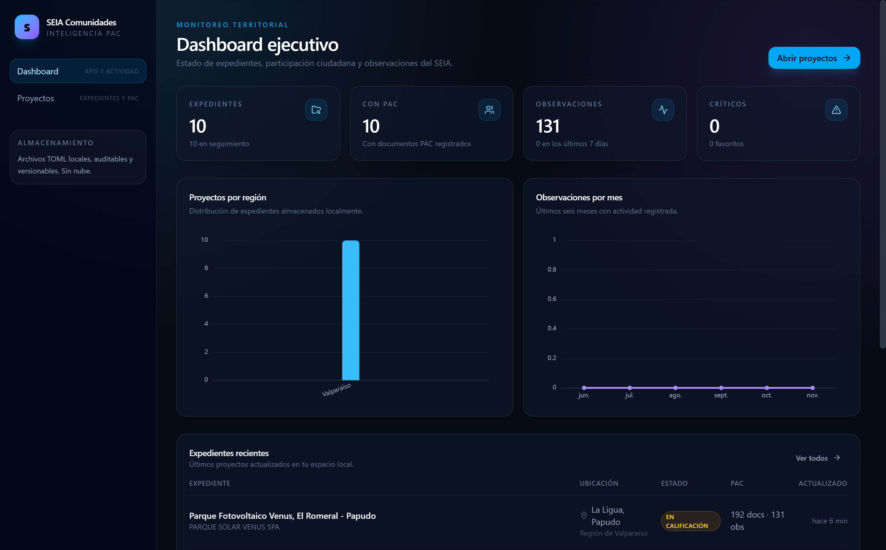
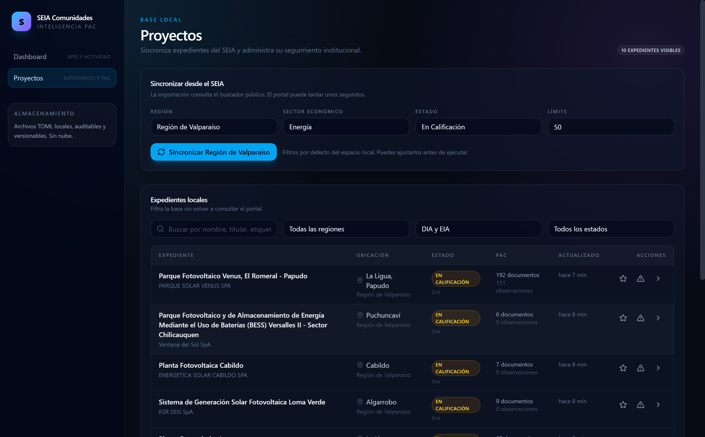
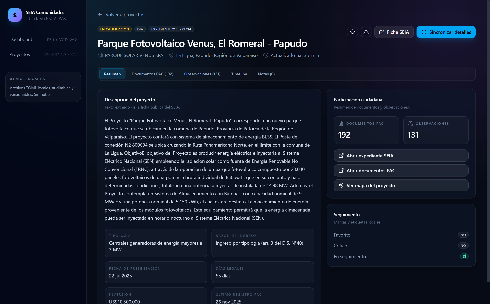
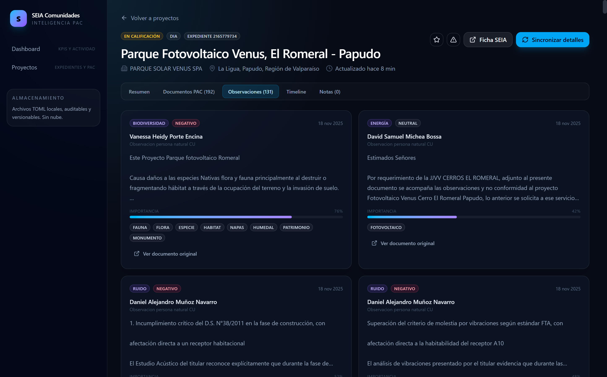
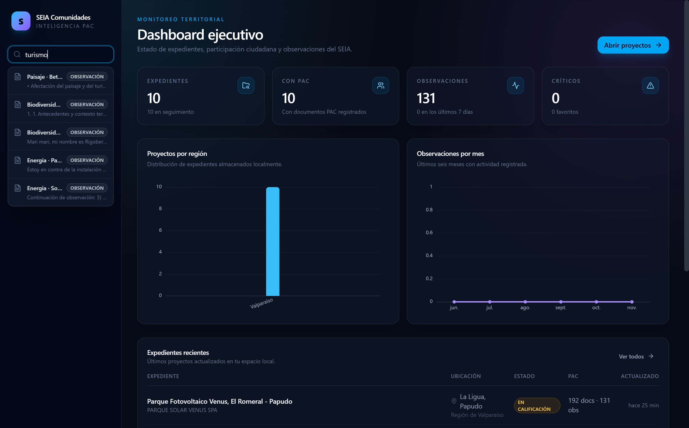
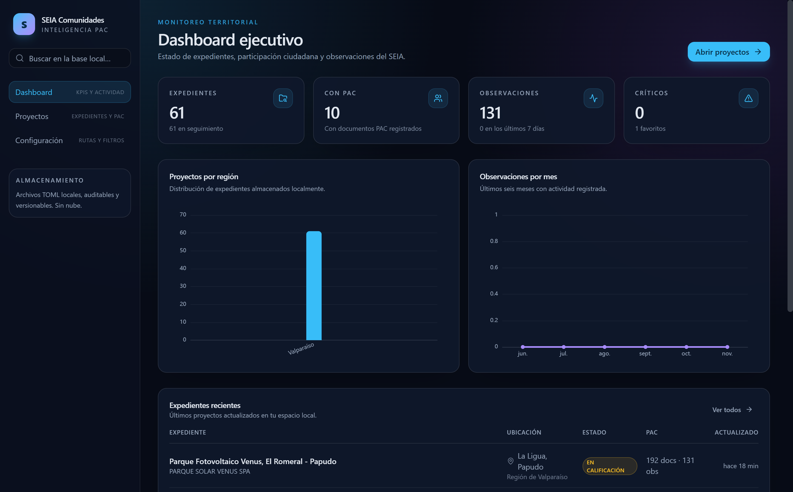
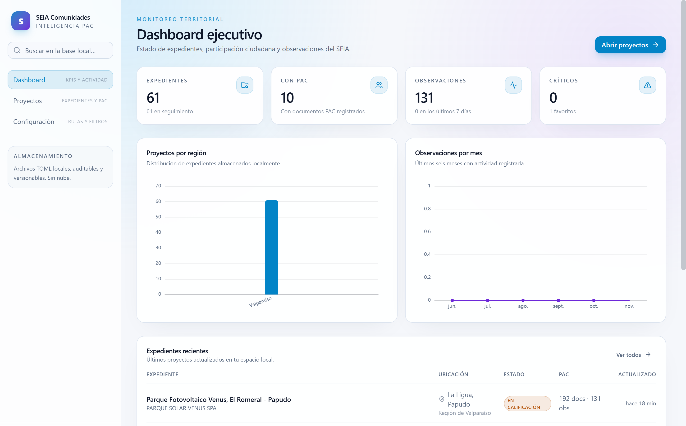

# SEIA Comunidades

Plataforma desktop-first para monitorear, almacenar y analizar procesos de Participación Ciudadana (PAC) del Sistema de Evaluación de Impacto Ambiental de Chile.

La aplicación reemplaza el flujo ETL de n8n por una arquitectura local, modular y auditable: **Electron + Astro + React + TypeScript + TOML**.

## Estado actual

Vertical slice funcional:

- Búsqueda de expedientes en el portal SEIA.
- Catálogos de regiones, comunas, sectores y estados.
- Persistencia TOML de proyectos, documentos PAC, observaciones, notas y timeline.
- Extracción y clasificación inicial de observaciones ciudadanas.
- Dashboard ejecutivo con KPIs y gráficos.
- Listado y detalle de expedientes con seguimiento (favorito, crítico, notas).
- Búsqueda global local con FlexSearch desde la barra lateral.
- Reportería por proyecto en CSV, XLSX, Markdown, HTML y PDF (Electron `printToPDF`).
- Tema **Claro / Oscuro / Sistema** persistente, con sincronización del chrome nativo de Electron.
- IPC tipado entre renderer y proceso principal.
- Fixtures reales del portal para tests deterministas.
- 29 tests unitarios/de integración.
- Instalador NSIS y versión portable generados con electron-builder.

Pendiente para completar el MVP:

- Mapas Leaflet con coordenadas ArcGIS.
- Motor de automatizaciones y scheduler.
- Firma de código y auto-update.
- IA local / RAG.

## Capturas















## Requisitos

- Node.js 22 o superior (probado con Node 24).
- pnpm 9 o superior.
- Windows para el empaquetado principal (Electron es multiplataforma).

## Instalación

```bash
pnpm install
```

## Desarrollo

```bash
pnpm dev
```

Esto levanta Astro en `http://127.0.0.1:4321` y Electron apuntando al servidor de desarrollo.

## Build y ejecución local

```bash
pnpm build
pnpm start
```

`pnpm build` genera:

- `dist/`: sitio Astro estático.
- `dist-electron/main.cjs`: proceso principal de Electron.
- `dist-electron/preload.cjs`: puente IPC seguro.

En producción empaquetada, el renderer se sirve mediante el protocolo `app://` y los datos viven en `app.getPath('userData')`. En desarrollo, el workspace es la raíz del repositorio.

## Tema claro / oscuro

El selector de apariencia está en la barra lateral y en **Configuración**:

- **Claro**: fuerza la paleta clara.
- **Oscuro**: fuerza la paleta oscura.
- **Sistema**: sigue `prefers-color-scheme` del sistema operativo.

La preferencia se guarda en `localStorage` (`seia.theme`) y se aplica antes del primer paint para evitar destellos. Además, el renderer sincroniza `nativeTheme.themeSource` con Electron para que la barra de título y los diálogos nativos acompañen al tema elegido.

Los colores se definen como tokens semánticos en `src/presentation/astro/styles/global.css` y se consumen con utilidades como `bg-background`, `text-foreground`, `bg-card`, `border-border` y `text-muted-foreground`.

## Sincronización con el SEIA

```bash
# Importar expedientes (por defecto: Valparaíso, Energía, En Calificación)
pnpm sync --limit 50

# Importar y luego traer ficha y documentos PAC de cada proyecto
pnpm sync --limit 20 --details

# Sincronizar un expediente específico
pnpm sync --project 2165779734
```

También puedes hacerlo desde la interfaz, en **Proyectos → Sincronizar desde el SEIA**.

La sincronización es incremental: actualiza los datos del expediente, conserva el seguimiento y las notas locales, y detecta observaciones nuevas.

## Fixtures y tests

```bash
# Capturar respuestas reales del portal en tests/fixtures/seia
pnpm fixtures

pnpm test
pnpm typecheck
```

Los fixtures incluyen búsqueda, catálogos, ficha, documentos PAC, contenido de un documento y destinatarios.

## Empaquetado

```bash
pnpm package
```

Genera instalador NSIS y versión portable en `release/`. La firma de código y el auto-update quedan para una etapa posterior.

## Arquitectura

```txt
electron/
  main.ts              # ventana, protocolo app://, bootstrap
  preload.ts           # contextBridge + API tipada
  ipc/handlers.ts      # handlers validados con Zod

src/
  app/                 # configuración y composition root
  domain/              # entidades y reglas puras (Zod)
  application/         # casos de uso, queries, puertos y mappers
  infrastructure/      # SEIA, TOML, caché, búsqueda, parsers
  presentation/        # Astro, islas React y componentes UI
  shared/              # IPC, errores, logger, eventos

tests/
  fixtures/seia/       # respuestas reales del portal
```

### Flujo

```txt
Isla React
  → window.seia.projects.syncSearch(...)
  → preload (allowlist de canales)
  → handler IPC (Zod)
  → caso de uso
  → SeiaGateway / repositorio TOML
  → eventos de dominio
  → índice FlexSearch + refresco de la UI
```

### Persistencia

```txt
data/
  projects/{id}.toml
  pac/{projectId}/{documentId}.toml
  observations/{projectId}/{observationId}.toml
  notes/{projectId}/{noteId}.toml
  timelines/{projectId}.toml
  catalogs/catalogs.toml
indexes/
  projects.toml
cache/
exports/
reports/
logs/
```

Los archivos TOML usan `schema_version`, escritura atómica y validación Zod. No se escriben valores `null`; los campos opcionales se omiten.

### Seguridad

- `contextIsolation: true`, `sandbox: true`, `nodeIntegration: false`.
- El renderer solo accede al filesystem/red a través de IPC allowlisted.
- Enlaces externos se abren con `shell.openExternal` y solo para `http(s)`.
- El contenido del portal se sanitiza al renderizar.
- CSP estricta, sin contenido remoto embebido.

## Notas sobre el portal SEIA

El portal actual (2026) difiere del workflow n8n original:

- `expediente.php?...&modo=ficha` redirige a `fichaPrincipal.php`.
- `xhr_documentos_pac.php` devuelve HTML con la tabla `tabla-dinamica_pac` (8 celdas por fila).
- `documento.php?idDocumento=` redirige a `infofirma.sea.gob.cl`; el contenido está en HTML con entidades.
- Las respuestas JSON y HTML usan ISO-8859-1; el visor de documentos no declara charset.
- El portal puede responder con un challenge JavaScript si el User-Agent no parece navegador. El cliente incluye un solver en sandbox y fallback de error accionable.
- Las coordenadas no están en el HTML: se resuelven vía ArcGIS con token (pendiente para la fase de mapas).

## Próximos pasos

1. Reportes y exportaciones (CSV, XLSX, Markdown, HTML, PDF con `printToPDF`).
2. Mapas Leaflet y resolución de coordenadas.
3. Reglas de automatización y scheduler.
4. Persistencia del índice FlexSearch y búsqueda global en la UI.
5. Empaquetado, firma y actualizaciones.
6. Integración opcional con Ollama para resúmenes, clustering y RAG local.
